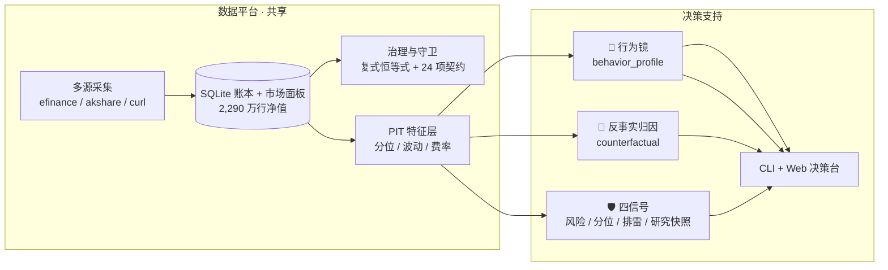

# 基于多源金融数据的个人基金投资决策支持系统

> 系统用 **2,290 万行**市场面板算出：**一面行为镜（核心）+ 四个信号（上下文）+ 反事实归因（证据）**，
> 递到用户手上；**用户自己下判断**，系统不代替决策。
>
> ⚠️ **「系统 vs 实例」诚实声明**：当前只有 **1 个 pilot 用户**（项目作者本人，真实资金）。
> 本文档中"系统"指**分析能力 + 决策支持输出**，**不是**多用户部署的产品——论文/复盘文档同此声明。
>
> **接手开发的智能体 / 协作者请先读 [`AGENTS.md`](AGENTS.md)**（环境 · 命令 · 铁律 · 去哪查）
> 与 [`docs/agents/HANDOFF.md`](docs/agents/HANDOFF.md) 顶部交接块。
> ⚠️ `.workbuddy/memory/` **不在 git 里**（本机速记），别把唯一副本写在那儿。

**目录**

- [这是什么？](#这是什么) —— 它做什么 / 不做什么
- [为什么是"决策支持"](#为什么是决策支持) —— 旧命题被自己证伪 → 换锚
- [快速开始](#快速开始) —— 装依赖 → 初始化 → 起网页
- [日常命令](#日常命令) —— 数据采集 / 行为审计 / 持仓管理
- [数据与隐私](#数据与隐私) —— ⚠️ 本仓库是公开的，先读这节
- [项目结构](#项目结构) · [系统架构](#系统架构) · [技术选型](#技术选型)
- [测试](#测试) · [离线研究模块与报告复现](#离线研究模块与报告复现)
- [方法论的文献依据](#方法论的文献依据)
- [重要提示](#重要提示) · [License](#license)

---

## 这是什么？

一个**个人研究项目（毕业设计）**：把「多源金融数据 → 个人基金操作审计」的全链路做扎实，
输出**决策支持**。当前处于**重构过渡期**：旧命题模块已归档冻结，新命题的「决策台」前后端
按 `docs/05-重构/01_决策支持系统_执行计划书.md` 施工中（后端 API → 前端三页）。

**它做什么**（能力均可复现）：

- 🧭 **行为镜**（`behavior`）：用你自己的流水算——买入前 20 日涨幅是否偏高（**追高对照**）、
  亏损卖出占比（**割肉**）、卖后 20 日走势（**卖飞**）、频率 ↔ 持有期分档收益。
  ⚠️ 先给**样本充分性声明**：数据不足以判断时**明说"不足以判断"、不出结论**（不做过度推断）。
- 🔁 **反事实归因**（`counterfactual` / `sell_rules`）：同一批买入，「完全不动 / 只定投 /
  按温度调仓」与实际操作对比（含 XIRR）；同标的「一次买入 vs 分批 vs 真实操作」；
  冻结买入、只变卖出规则的同口径对比。
- 💰 **回本门槛**（`breakeven`）：每笔持仓「**要涨多少才不亏**」（申购费 + 赎回费惩罚期），
  7 天惩罚期内赎回的金额、离"免费赎回"还有几天。
- 🛡️ **四个信号**（上下文，决策台施工中）：持仓**风险刻画**（波动 / 回撤 / 夏普）、
  **同类分位**、**排雷**（同类夏普垫底 / TER 费率偏高——两个可辩护判据）、**研究快照**（离线报告）。
- 📡 **数据平台**：全市场净值面板（采集 → 治理 → 分层 → PIT 特征），
  配数据契约守卫：账本**复式记账恒等式** + 市场数据共 **24 项**只读检查
  （`python scripts/check_ledger_invariants.py`，0 失败为绿）。
- ✏️ **账本工具**：持仓增删改、定投（DCA）、投资计划、对账与净值更新（Web 界面）。

**它不做什么**（每条都是实测结论，不是谦虚）：

- ❌ **不选基、不预测收益**——旧命题「温度择时 / 选基排序」**已被自己的回测证伪**（见下节），
  模块**归档冻结**在 `legacy/`（`git mv`，不是删除）；
- ❌ 不自动下单（场外基金不支持 API 交易，所有下单在支付宝手动执行）；
- ❌ 不替用户下判断——系统只把度量、对照、证据递到手边。
- ⚠️ **唯一保留的"预测"是可辩护的那类**：波动率可预测、bottom decile 剔除显著——
  与"预测收益 / 选基"（不可辩护）划清界限。

## 为什么是"决策支持"

旧命题在结构上不成立（诊断全文：`docs/05-重构/00_重构蓝图.md`）：

| 结论 | 证据 |
|:---|:---|
| 无执行闭环 | 场外基金**不能程序化下单**；支付宝没有个人基金 API |
| alpha 被自己证伪 | 策略回测：相对沪深300 月度 alpha **p=0.38**、相对中证500 **p=0.56**（均不显著） |
| 文献一致 | Carhart(1997) / SPIVA / Morningstar：主动基金持续性弱、多数跑输 |
| 工程层是好的 | 账本复式恒等式 0 不平 · 数据契约 24 项全绿——**错的是命题层，不是工程层** |

⇒ **换锚**：数据平台与行为审计保留，命题重定为「决策支持」。
旧命题模块整体归档 `legacy/`（含其测试与报告），工程资产独立为本仓库的主线。

行为审计的卖点**不依赖 alpha、不依赖预测**——它度量的是"你实际操作得怎么样"：
追高对照差值、亏损卖出占比、赎回费漏损、同标的择时差等（复现见下节命令）。

## 快速开始

### 1. 安装依赖

```bash
pip install -r requirements.txt
```

### 2. 一键初始化（首次使用执行一次）

```bash
python src/main.py init
```

自动完成五步：数据源连通自检 → 采集基金列表与指数估值 → **刷新交易日历** →
采集基金净值历史 → 补充基金详情（实测约 15–25 分钟，净值采集最耗时；`enrich` 另花几分钟）。

> 也可以分步执行：`python src/main.py test` / `collect` / `calendar` / `nav` / `enrich`
> 采集类命令跑完会自动失效 Web 缓存快照，回到页面即可看到新数据。

### 3. 启动 Web 界面

```bash
python src/main.py precompute  # 可选：预计算快照，让首屏免冷算
python src/main.py web         # http://localhost:5020（仅监听本机）
# 想同时跑第二份（对照/调试）：QFA_PORT=5021 python src/main.py web
```

## 日常命令

```bash
# 数据准备（首次 / 日常）
python src/main.py init        # 一键初始化
python src/main.py test        # 数据源连通自检
python src/main.py collect     # 采集全市场基金列表 + 指数估值
python src/main.py index       # 只更新指数估值（PE/PB）
python src/main.py nav         # 采集基金净值历史
python src/main.py snapshot    # 全市场当日净值快照（日常增量主路径）
python src/main.py enrich      # 补充基金详情（经理 / 费率等）
python src/main.py fees        # 补采真·运作费率（可断点续采）
python src/main.py calendar    # 刷新交易日历（T+1 确认 / 定投跳过节假日）
python src/main.py hithink     # 同花顺 HiThink 连通性自检（未接入采集链路）

# 行为审计（只读；回答「我自己的操作值多少」）
python src/main.py behavior        # 行为画像（追高 / 割肉 / 卖飞 / 频率）
python src/main.py counterfactual  # 反事实归因（当时不动 / 只定投 / 照温度动）
python src/main.py sell_rules      # 同标的卖出规则对比（冻结买入，只变卖出）
python src/main.py breakeven       # 回本门槛（这笔要涨多少才不亏）
python src/main.py drift           # 风格漂移检测（CUSUM + PELT）

# 持仓 / 计划
python src/main.py portfolio   # 持仓盈亏与资产配置
python src/main.py buy         # 记录买入（交互式）
python src/main.py sell        # 记录卖出（交互式）
python src/main.py update      # 修改持仓（投入金额 / 买入日期）
python src/main.py delete      # 删除持仓（处理重复录入）
python src/main.py dca         # 定投管理（list/add/run/pause/resume）
python src/main.py plan        # 投资计划 + 进度

# 看板 / 自动化
python src/main.py web         # 起 Web（:5020）
python src/main.py precompute  # 预计算快照（首屏免冷算）
python src/main.py schedule    # 定时调度（每周日 20:00）
```

> 分析与审计命令（`behavior` / `counterfactual` / `portfolio` 等）为**只读且不联网**
> （只读本地 `data/fund_quant.db`）；联网只发生在采集类命令与 Web 运行时的行情请求。
> 命令总数 **25 个**（`python src/main.py help` 查看完整命令表）。

## 数据与隐私

⚠️ **本仓库是公开的**（`github.com/Mo12y/Quantitative-Fund-auto`），请先读完本节。

**已经在公开历史里的个人数据**：`src/analysis/investment_plan.py` **曾经**把投资计划**硬编码**在源码里，
包含真实基金代码、金额、日期（例如计划总额 1000 元、现金弹药 280 元、各笔买入的日期与金额）。
无账号、无身份信息，但足以还原你的持仓结构 —— 这些内容**已经推送到公开仓库且存在于历史提交中**
（即便现在已外置，历史提交里仍有，见下表第二行）。

**2026-09-25 起：计划已外置**（F-01）。源码里只保留一份**示例**计划，真实计划在
`config/investment_plan.local.yaml`（**已 .gitignore**）。读取优先级：
数据库 `investment_plans` 表 → 本地配置 → 内置示例。新用户复制
`config/investment_plan.local.example.yaml` 即可起步。

**不受影响的**：数据库与运行时产物**不会**入库（`.gitignore` 覆盖 `*.db` / `*-wal` / `*-shm`、
`data/backups/`、`data/cache/`、`data/*_results/`）；`docs/screenshots/` 也已忽略
（那几张截图是真实持仓界面，比源码更直观）。

**如果你想脱敏**，两个层次：

| 做法 | 效果 | 状态 |
|---|---|---|
| 把 `FUNDS` / `TOTAL_CAPITAL` 抽到本地配置文件并加进 `.gitignore` | 之后的提交不含真实数据 | ✅ **已实现**（2026-09-25，F-01）。源码只留示例计划；真实计划在本地文件里 |
| 用 `git filter-repo` / BFG 重写历史后强推 | 连历史里的数据也清掉 | ⏳ 未做（会**改写公开历史**，其他人的 clone / fork 会不一致，需谨慎） |

其余数据说明：
- 系统只读公开市场数据（基金净值、指数估值），不涉及任何账户/交易凭证；
- 没有任何下单能力，所有操作都需要你在支付宝手动执行。

## 项目结构

```
Quantitative-Fund-auto/
├── AGENTS.md                    # 🤖 多智能体协作入口（环境/命令/铁律/去哪查）
├── config/                      # 配置（settings.yaml；*.local.yaml 不入库）
├── data/                        # 数据库与缓存（gitignore；账本 = fund_quant.db）
├── docs/                        # 📄 文档（索引见 docs/README.md）
│   ├── 00-规范/                 #   核心数字唯一权威（结论权威口径.md）
│   ├── agents/                  #   协作层：STATUS / HANDOFF / TASKS
│   ├── 05-重构/                 #   换锚蓝图 + 决策支持系统执行计划书
│   └── _archive/                #   过期/历史文档
├── frontend/                    # 🌐 React 前端（Vite + TS + Tailwind v4；Flask 托管挂 /）
├── legacy/                      # 🗄️ 已归档冻结的旧命题模块（git mv，非删除）
├── scripts/                     # 🔧 运维脚本（数据契约守卫 / 回填 / 体检）
├── src/
│   ├── analysis/                # 分析层（行为审计 / 反事实 / 风险指标 / 同类分位 / 账本写入门面…）
│   ├── cli/                     # CLI 命令包（数据结构 / 分析 / 输出）
│   ├── data/                    # 数据层（采集 / SQLite）
│   ├── web/                     # Flask 后端 API（React 前端的宿主）
│   ├── config.py                # 配置中心（settings.yaml 类型化访问）
│   └── main.py                  # 🚀 主入口（CLI 分发）
├── tests/                       # ✅ 单元测试（pytest，541 用例）
└── requirements.txt
```

## 系统架构



> 四层职责（蓝图 §三）：L1 采集 → L2 治理 → L3 分层数仓 → L4 PIT 特征；其上跑
> L5 账本 / L6 行为审计 / L7 行为建模 / L8 交付。「四信号」与决策台的落地进度见执行计划书。

## 技术选型

| 组件 | 选型 | 理由 |
|------|------|------|
| 数据源 | efinance（净值主）+ akshare（备）+ curl + 东方财富（交易日历） | 净值历史优先 efinance（更稳、含累计净值），失败回退 akshare；Python 直连外网不稳时交易日历用 curl 子进程 |
| 存储 | SQLite（WAL） | 单机个人使用，零配置零运维；当前 **2.79 万只基金基本信息 + 2,290 万条净值记录**完全够用；已开 WAL + busy_timeout，配合 Flask 多线程降低锁冲突。**不为"像大数据"硬塞 Spark/Hive**（2.4 GB 不是大数据体量） |
| 语言 | Python 3.10+ | 金融数据生态成熟（pandas / numpy） |
| CLI | rich | 终端彩色输出、表格、进度条，报告可读性好 |
| Web | Flask + React/Vite | 后端单文件可起服务；前端独立构建、由 Flask 托管（个人工具不需要更重的东西） |
| 配置 | YAML | 策略参数与代码分离；本机私有配置 `*.local.yaml` 不入库 |

## 测试

```bash
CODEBUDDY_SAFE_DELETE_BULK_THRESHOLD=100000 python -m pytest tests/ -q
```

当前基线 **541 passed**（重构中会随命题层模块归档而变化，历史轨迹记录在
`docs/00-规范/结论权威口径.md` §三）。覆盖：数据契约守卫自身（逐条注入违规必须点名报红）、
行为画像与反事实口径、T+1/T+2 交易规则与持仓落账、定投期次、组合曲线、账本写入门面的
原子性（`immediate()` 负对照）、同类分位参照系、TER 费率口径、文档引用完整性与必读链预算等。
纯逻辑用例无需数据库与网络（读路径不联网）。

## 离线研究模块与报告复现

以下研究不参与日常使用；每份报告都可用一条命令重新生成（**不要手改报告里的数字**）。
部分模块已随旧命题归档 `legacy/`，复现命令同步指向新位置：

| 报告 | 复现命令 |
|------|---------|
| `docs/vol_prediction_report.md` | `python src/analysis/vol_predictor.py --max-funds 200` |
| `docs/drawdown_warning_report.md` | `python src/analysis/drawdown_warning.py --thresholds 3,5,8` |
| `docs/portfolio_simulation_report.md` | `python src/analysis/portfolio_simulation.py --dd-threshold 8` |
| `docs/vol_model_comparison_report.md` | `python legacy/src/analysis/vol_model_comparison.py` |
| `docs/factor_test_report.md` | `python legacy/src/analysis/factor_test.py` |

**这几个模块的共同口径**（2026-09 审计后统一）：

- 基线与 ML 模型一律限制在同一 OOS 月份集合后再评分；
- QLIKE 用 Patton(2011) 标准**方差**形式；
- 回撤在**复权净值**（累计净值）上计算，除息日不算回撤；
- 组合模拟的仓位信号**严格滞后一期**（用 m−1 及之前的预测给 m 月定仓位）；
- 回撤标签的阈值/模型组合在**验证段**选出、在**测试段**报告，并做多重比较校正；
- 每份报告末尾都有「已知局限与口径说明」。

## 方法论的文献依据

本项目用到的方法与口径不是拍脑袋定的，多数有明确文献来源。列在这里，一是让选型可追溯，
二是**方便后人核验**（本项目吃过"抄了没核实的数字"的亏）。

| 本项目的方法 | 文献依据 | 核验状态 |
|---|---|---|
| QLIKE 损失函数（**方差**形式，非波动率形式） | Patton A J. *Data-based ranking of realised volatility estimators*. Journal of Econometrics, 2011, 161(2): 284-303 | ✅ 领域标准，DOI 可查 |
| HAR-RV 波动率预测框架 | Corsi F. *A simple approximate long-memory model of realized volatility*. Journal of Financial Econometrics, 2009, 7(2): 174-196 | ✅ 奠基文献 |
| XGBoost 模型 | Chen T, Guestrin C. *XGBoost: a scalable tree boosting system*. KDD 2016: 785-794 | ✅ 奠基文献 |
| 随机森林（对照模型） | Breiman L. *Random forests*. Machine Learning, 2001, 45(1): 5-32 | ✅ 奠基文献 |
| 多因子模型（因子维度设计的思想来源） | Fama E F, French K R. *Common risk factors in the returns on stocks and bonds*. Journal of Financial Economics, 1993, 33(1): 3-56 | ✅ 奠基文献 |
| 基金绩效持续性 / 四因子归因 | Carhart M M. *On persistence in mutual fund performance*. The Journal of Finance, 1997, 52(1): 57-82 | ✅ 奠基文献 |
| 多重检验校正（因子检验的 Bonferroni 等） | White H. *A reality check for data snooping*. Econometrica, 2000, 68(5): 1097-1126 | ✅ 奠基文献 |
| 回测过拟合风险 | Bailey D H, Borwein J M, López de Prado M, et al. *The probability of backtest overfitting*. Journal of Portfolio Management, 2022, 48(5): 120-131 | ⚠️ 主题确凿（López de Prado 系列），**具体卷期待核** |
| ML 做资产定价的经济价值与显著性分离 | Gu S, Kelly B, Xiu D. *Empirical asset pricing via machine learning*. The Review of Financial Studies, 2020, 33(5): 2223-2273 | ✅ 高被引，DOI 可查 |
| **费率（TER）是预测后续净回报最有效的单变量之一** | Morningstar：Kinnel R. (2016) 标杆研究 + 2025 年 20 年复现（Russel Kinnel / Jeffrey Ptak）；晨星中国 TER 口径 | ✅ **本项目独立核验过**（见 `docs/参照系接入执行报告.md` §8.5） |
| 同侪百分位 / 组内分位（不做单一绝对阈值） | 同上（晨星"同类内比较"方法），外加本项目实测：TER 中位权益 1.40% vs 债券 0.50%（差 2.8 倍） | ✅ 实测支撑 |

> ⚠️ **关于课程作业那份 25 篇文献清单**（`D:\DSH\courses\wenxianjiansuo\...\参考文献清单.md`）：
> 它的外文经典部分（上表带 ✅ 的）与本项目一致且可查；但**其中的中文文献（如"陈锐 2024 五维评价框架"
> "刘志东 2023 XGBoost-HAR"）题录存疑**，原清单自己也标注"需在知网最终核实"。
> **本项目不引用未核实的中文条目** —— 需要时请先到知网确认作者与卷期。

## 重要提示

⚠️ **本系统仅供学习参考，不构成投资建议。**
- 历史表现不代表未来收益；量化模型可能失效；投资有风险，入市需谨慎；
- 场外基金 T+1 确认，短线操作成本高（本项目专门度量这类成本：`breakeven` 命令）；
- 🔒 个人数据与公开仓库的注意事项见上文 **[数据与隐私](#数据与隐私)**。

## License

MIT — 个人学习项目
